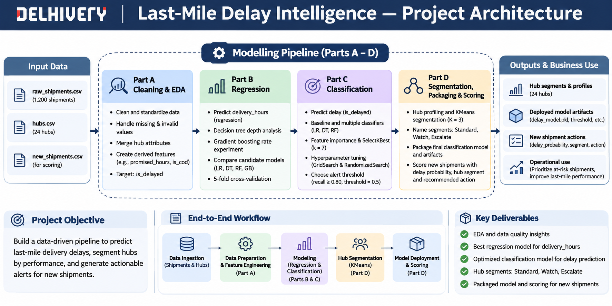

# Capstone Project - Delhivery Last-Mile Delay Intelligence Pipeline

## Project Overview

At Delhivery, one of India's largest logistics networks, every parcel is booked with a promised delivery time (Express 36 hours, Standard 60 hours, Economy 96 hours). There are three open problems and no pipeline that answers any of them:

- **How long will a parcel really take?** Planners need a delivery-hours estimate for each parcel at dispatch time.
- **Which parcels will miss their promise?** Ops can place a proactive customer call or escalate to a hub manager, but only for parcels flagged before they are late. A missed delayed parcel costs more than an unnecessary call.
- **Which hubs need which playbook?** Each of the 24 hubs is labelled Tier 1, 2 or 3, but nobody has checked whether the label matches how the hub really behaves.

## Project Architecture and Solution

To answer the above questions, we need to create a pipeline in one connected repository that has below steps.
- **Part A - Data Foundation**: Clean the raw shipment data, engineer features, and perform exploratory data analysis to identify delay patterns.
- **Part B - Regression**: Build and evaluate models to predict the actual delivery time in hours for each shipment.
- **Part C - Classification**: Build a model to predict shipment delays, select relevant features, tune the model, and determine an alert threshold.
- **Part D - Hub Segmentation**: Cluster hubs by operational performance, identify mismatches with official tiers, and package the trained model.
- **Final Script**: Score new shipments, estimate delay probabilities, assign hub segments, and generate recommended operational actions.



Note - The data is synthetic. Delhivery's real shipment records are never used. Every row in this brief's dataset is produced by the generator script below; the brand is only the setting for the decisions.

## Repository Structure

- `generate_data.py` - provided data-generation script.
- `src/shipment_prep.py` - shared data cleaning and feature engineering.
- `part_a_clean_eda.py` - data cleaning and exploratory analysis.
- `part_b_regression.py` - delivery-time regression experiments.
- `part_c_classification.py` - shipment-delay classification modelling.
- `part_d_segments.py` - hub profiling and segmentation analysis.
- `package_model.py` - classification model packaging.
- `predict_delay.py` - delay prediction and operational actions recommendation.
- `data/` - generated datasets and modelling table.
- `models/` - saved model artifacts.
- `outputs/` - analysis and modelling outputs.
- `references/` - reference metrics provided by the Capstone PDF.

## Setup and Execution (How to Run)

Run the commands from the repository root.

**1. Get the latest version from GitHub**

For a new clone:

```bash
git clone https://github.com/gauravm-masai/last-mile-delay-intelligence-pipeline.git
cd last-mile-delay-intelligence-pipeline
```

For an existing clone, pull the latest changes:

```bash
git pull origin main
```

**2. Install dependencies**

```bash
python -m pip install -r requirements.txt
```

**3. Generate the input datasets**

```bash
python generate_data.py
```

**4. Run Part A — Data Foundation**

```bash
python part_a_clean_eda.py
```

**5. Run Part B — Regression**

```bash
python part_b_regression.py
```

**6. Run Part C — Classification**

```bash
python part_c_classification.py
```

**7. Run Part D — Hub Segmentation**

```bash
python part_d_segments.py
```

**8. Package the classification model**

```bash
python package_model.py
```

**9. Score new shipments**

```bash
python predict_delay.py
```

Run the steps in order so each stage has the inputs generated by the preceding stages.

## Production plan

The current implementation demonstrates the end-to-end workflow on synthetic data. Before operational deployment, the following controls and monitoring practices should be introduced.

**Production-readiness characteristics**

| Characteristic | Implementation in this repository | Further production consideration |
|---|---|---|
| Accuracy | The classifier produces delay probabilities and is evaluated using precision, recall, and F1. | Evaluate performance on representative real operational data before deployment. |
| Reliability | The scoring pipeline checks the alert threshold and applies defined action rules. | Add logging, exception handling, and operational alerts for failed scoring runs. |
| Reproducibility | Fixed random states, pinned feature order, and versioned dependencies support repeatable results. | Version datasets, model artifacts, and validation reports alongside each release. |
| Performance | The saved pipeline scores a batch of 48 new shipments without retraining during prediction. | Benchmark throughput and latency against the expected production shipment volume. |
| Maintainability | Cleaning and feature engineering are shared through `src/shipment_prep.py`. | Maintain automated tests for preprocessing, feature schemas, and scoring rules. |
| Consistency | Training and prediction use the same feature definitions and stored imputation medians. | Prevent independent changes to training and inference preprocessing. |
| Monitorability | The output records delay probabilities, flags, segments, and recommended actions. | Record actual delivery outcomes and compare them with predictions to detect performance deterioration. |

**Monitoring metrics and proposed triggers**

The following are proposed operational monitoring thresholds, not measurements from the current validation report. They should be reviewed and calibrated using representative production data.

| Metric | Monitoring frequency | Proposed trigger | Recommended response |
|---|---|---|---|
| Actual delay rate among delivered shipments | Weekly | Exceeds 25% for two consecutive weeks, outside a known special-event period | Investigate changes in routes, hub operations, service mix, and delivery performance. |
| Share of shipments flagged by the model | Daily or weekly | Exceeds 30% of scored shipments for two consecutive reporting periods | Review the shipment mix, probability distribution, and operational conditions before changing the threshold. |
| Recall on shipments whose delivery outcomes are known | Weekly, when sufficient labelled data is available | Falls below 0.70 over a rolling evaluation window containing at least 100 delayed shipments | Investigate missed delays, review feature quality, and evaluate recalibration or retraining. |
| Missing or invalid scoring records | Every scoring run | Any missing required feature, duplicate shipment ID, invalid probability, or action-rule violation | Quarantine the affected batch and investigate the data or pipeline failure. |

The numeric triggers above are initial proposals. Production thresholds should be approved by the operations team and adjusted after establishing a reliable baseline.

**Retraining and sale-event handling**

A reasonable initial production schedule is to review model performance weekly and evaluate retraining monthly. Retraining should also be considered after a sustained deterioration in recall, a material change in shipment characteristics, or a significant operational change.

The sale window represented by `sale_event_flag` requires special treatment. Shipments during the 15-28 September sale period should be compared with equivalent sale periods where historical data is available, rather than being compared only with ordinary weeks.

This comparison helps distinguish expected event-related changes from genuine model deterioration.

Data drift may appear as changes in distance, parcel weight, service type, hub distribution, dispatch times, sale-event frequency, predicted delay probabilities, or the actual delay rate. Changes in the relationships between these features and delivery outcomes may also indicate that the existing model no longer reflects operational conditions.

Before retraining, the team should verify data quality, investigate the cause of the change, evaluate the candidate model on an appropriate validation set, and compare its performance with the deployed version.

## Operations Recommendations

**Prioritize the Escalate segment**

The nine hubs in the Escalate segment have an average delay rate of **46.00%**, compared with 15.50% for Watch and 2.57% for Standard.

The regional operations team should prioritize these nine hubs for investigation into long-distance routes, high stop counts, delivery capacity, and operational bottlenecks.

The segment should guide the intensity of operational review, while shipment-level delay probabilities determine which individual parcels need immediate intervention.

**Investigate the four tier mismatches**

The following hubs should be reviewed because their observed operating segments do not match the segment implied by their official tier.

- **HUB07, Kolkata (Tier 1 → Watch):** Investigate why its observed delay rate and operational profile differ from the expected Standard segment.
- **HUB13, Nagpur (Tier 2 → Escalate):** Prioritize operational investigation because its observed performance indicates a greater delay risk than its official tier suggests.
- **HUB15, Kochi (Tier 2 → Escalate):** Review its operational performance and determine whether additional corrective measures are needed.
- **HUB22, Dehradun (Tier 3 → Watch):** Investigate the difference between its official tier and observed operating performance.

These mismatches should inform operational reviews and future tier assessments. They do not, by themselves, establish that an official tier assignment must be changed.

**Use the alert threshold to guide interventions**

The selected alert threshold is **0.5**. A shipment is flagged when its predicted probability of delay is greater than or equal to this threshold.

On the Part C test set:

- Precision is **0.6889**: approximately 7 out of every 10 flagged parcels were actually delayed.
- Recall is **0.7561**: approximately 8 out of every 10 delayed parcels were correctly identified.

These results provide a basis for proactive intervention, although they also show that some flagged parcels will not be delayed and some delayed parcels will be missed.

For the 48 new shipments, the scoring output flagged **8 shipments**. Of these, **6 require escalation to a hub manager**, while **2 require proactive customer calls**. The other 40 shipments do not meet the selected alert threshold and receive no action under the defined rules.

The model's predictions should support operational prioritization rather than replace human judgment.

**Retain three operational segments**

The across-to-within distance ratio increases from 2.8940 for K = 2 to 5.3928 for K = 3, 6.3047 for K = 4, and 6.8866 for K = 5.

Although four and five clusters provide higher separation ratios, both solutions contain clusters with fewer than six hubs. Such small groups would be difficult to support with distinct operational playbooks.

The three-cluster solution is therefore retained to balance meaningful separation with practical operational coverage. The Standard, Watch, and Escalate segments provide a manageable structure for hub monitoring and escalation.

## Limitations

1. **Synthetic dataset:** The project uses generated shipment records rather than real Delhivery operational data. Its results demonstrate the pipeline's functionality but do not establish real-world model performance.

2. **Limited test-set evidence:** The classification test set contains only 180 shipments, including 41 delayed parcels. Precision, recall, and F1 may vary when evaluated on a larger or different sample.

3. **Threshold selected on one validation split:** The alert threshold of 0.5 was selected using the prescribed validation data. Its performance may change with a different shipment mix, operational conditions, or delay prevalence.

4. **Hub profiles based on limited observations:** Each hub's profile is calculated from 50 historical shipments. These observations may not capture seasonal variations, unusual operating conditions, or longer-term changes in hub performance.

5. **Cluster assignments depend on the observed data:** The three segments summarize the operational profiles in this dataset. Hub assignments may change when the underlying data or operating conditions change, so the segments should be reviewed periodically.

6. **Predicted probabilities are not guarantees:** A flagged shipment may still be delivered on time, and an unflagged shipment may be delayed. Operational teams should use the predictions to prioritize interventions, not treat them as certain outcomes.

7. **Proposed production triggers require calibration:** The monitoring thresholds and retraining schedule are initial recommendations. They should be validated against real shipment volumes, business costs, and operational requirements before deployment.

## Part A: Data Cleaning and Exploratory Data Analysis

### Objectives
Part A prepares the shipment dataset for downstream analysis and modelling. The main objectives are to clean and standardize shipment data, handle missing and invalid values, combine shipment records with hub information, engineer the required features, and define whether each shipment was delayed based on its promised delivery time.

### High-level approach
1. **Data cleaning:** Remove duplicate shipment records, standardize service types, handle missing payment modes, convert declared values to numeric format, treat invalid parcel weights as missing, and impute missing numeric values using historical medians.
2. **Feature engineering and hub integration:** Merge shipment records with hub information and create the required features, including promised delivery hours, log-transformed declared value, weekend and COD indicators, and dispatch hour.
3. **Delay labelling:** Compare actual delivery hours against the promised delivery hours for each service type to create the binary `is_delayed` target.
4. **Validation and quality checks:** Calculate data-quality metrics and compare them against reference values to verify that the cleaning and feature engineering steps produce the expected results.
5. **Exploratory analysis:** Generate delay-rate summaries by service type, hub tier, and distance band, along with a numeric correlation matrix to examine relationships between features and delivery hours. Distance bands are defined using right-inclusive bins with edges `[0, 200, 400, 600, 2000]` and labels `0-200`, `201-400`, `401-600`, and `601+`. The lowest boundary is included in the first bin.

The outputs include the cleaned modelling table, validation reports, delay summaries, and correlation matrix. These outputs provide a consistent, validated dataset and an initial understanding of the factors associated with delivery delays before proceeding to subsequent modelling tasks.

### Data findings

**Data quality and preparation**

- The raw dataset contained **1,224 rows**. Removing **24 duplicate rows** left **1,200 shipments**.
- Before cleaning, there were 36 missing distance values, 24 missing parcel-weight values, 5 sentinel parcel-weight values, 12 missing declared-value values, and 18 missing payment-mode values.
- Service-type spellings were standardized from 12 observed spellings to 3 categories: Economy, Express, and Standard.
- The hub merge retained all **1,200 shipments**. The required feature columns and target contained no missing values in the final modelling table.
- There were **278 delayed shipments**, giving an overall delay rate of **23.17%**.

**Delay rate by service type**

Express shipments had the highest delay rate at **48.97%** (119 delayed out of 243). Standard shipments had a delay rate of **20.56%** (132 out of 642), while Economy shipments had the lowest rate at **8.57%** (27 out of 315).

**Delay rate by hub tier**

The delay rate increased with hub tier: **4.00% for Tier 1**, **21.50% for Tier 2**, and **44.00% for Tier 3**. These results show a clear association between hub tier and delay rate in this synthetic dataset.

**Delay rate by distance band**

Delay rates rose as distance increased:

- **0-200 km**: 2.19%
- **201-400 km**: 13.68%
- **401-600 km**: 43.64%
- **601+ km**: 85.23%

The highest distance band had the highest observed delay rate, with 75 of 88 shipments delayed.

**Correlation with delivery time**

Excluding `delivery_hours` itself, the three columns with the strongest absolute correlations with `delivery_hours` were:

- promised_hours: **+0.8372**
- distance_km: **+0.4013**
- n_stops: **+0.3247**

These are correlations, not evidence of causation. The correlation-validation rows in the table below also include a separate check for `is_delayed` against `distance_km`; that check is not one of the three strongest correlations with `delivery_hours`.

**Log transformation of declared value**

After cleaning and filling missing declared values, the mean declared value was **INR 1,533.05** and the median was **INR 1,121.50**. The corresponding mean and median of `log_declared_value` were **7.028** and **7.022**, respectively. The difference between the original mean and median indicates right-skew in declared values. The log transformation reduces the influence of large values and makes the distribution less skewed.

### Validations

#### Acceptance criteria and results

The Part A validation checks cover data quality, duplicate removal, missing-value and sentinel counts, service-type standardization, imputation statistics, hub-merge row counts, missing values in features and target, delay statistics, group-level delay metrics, and selected correlation checks. The validations consist checks for 26 quality metrics, 30 group-level metrics, and 3 correlations.

The modelling table contains 1,200 rows, preserves the required feature and target data without missing values, and retains all rows through the hub merge. The detailed reference-versus-code comparisons are below.

#### Reference metrics compared with generated outputs

| Source file | Metric | PDF reference value | Code-generated value | Tolerance | Status | Comments |
|---|---|---:|---:|---|---|---|
| `outputs/part_a_checks.csv` | `raw_rows` | 1224 | 1224 | Exact | PASS | Confirms the raw shipment dataset contains the expected 1,224 rows. |
| `outputs/part_a_checks.csv` | `duplicate_rows_removed` | 24 | 24 | Exact | PASS | Confirms that the expected 24 duplicate rows were removed. |
| `outputs/part_a_checks.csv` | `rows_after_dedup` | 1200 | 1200 | Exact | PASS | Confirms 1,200 shipment rows remain after deduplication. |
| `outputs/part_a_checks.csv` | `missing_distance_km_before` | 36 | 36 | Exact | PASS | Matches the expected number of missing distance values before imputation. |
| `outputs/part_a_checks.csv` | `missing_parcel_weight_before` | 24 | 24 | Exact | PASS | Matches the expected number of missing parcel-weight values before cleaning. |
| `outputs/part_a_checks.csv` | `sentinel_weight_rows` | 5 | 5 | Exact | PASS | Confirms five parcel-weight records contain sentinel values that must be treated as missing. |
| `outputs/part_a_checks.csv` | `missing_declared_value_before` | 12 | 12 | Exact | PASS | Matches the expected number of missing declared-value records before imputation. |
| `outputs/part_a_checks.csv` | `missing_payment_mode_before` | 18 | 18 | Exact | PASS | Matches the expected number of missing payment-mode values before replacement. |
| `outputs/part_a_checks.csv` | `service_type_spellings_before` | 12 | 12 | Exact | PASS | Confirms the expected number of distinct service-type spellings before standardization. |
| `outputs/part_a_checks.csv` | `service_type_spellings_after` | 3 | 3 | Exact | PASS | Confirms service-type standardization reduces the distinct spellings to three. |
| `outputs/part_a_checks.csv` | `declared_value_mean_inr` | 1533.05 | 1533.0542 | ±0.01 | PASS | The generated mean declared value is within the reference tolerance. |
| `outputs/part_a_checks.csv` | `declared_value_median_inr` | 1121.5 | 1121.5000 | ±0.01 | PASS | The generated median declared value matches the reference within tolerance. |
| `outputs/part_a_checks.csv` | `log_declared_value_mean` | 7.028 | 7.0277 | ±0.01 | PASS | The mean log-transformed declared value matches the reference within tolerance. |
| `outputs/part_a_checks.csv` | `log_declared_value_median` | 7.022 | 7.0224 | ±0.01 | PASS | The median log-transformed declared value matches the reference within tolerance. |
| `outputs/part_a_checks.csv` | `median_distance_km` | 314.95 | 314.9500 | ±0.01 | PASS | The generated median distance matches the reference within tolerance. |
| `outputs/part_a_checks.csv` | `median_parcel_weight_kg` | 1.83 | 1.8300 | ±0.01 | PASS | The generated median parcel weight matches the reference within tolerance. |
| `outputs/part_a_checks.csv` | `median_declared_value_inr` | 1121.5 | 1121.5000 | ±0.01 | PASS | Confirms the declared-value median used for imputation matches the reference. |
| `outputs/part_a_checks.csv` | `rows_after_hub_merge` | 1200 | 1200 | Exact | PASS | Confirms the hub merge preserves all 1,200 shipment rows. |
| `outputs/part_a_checks.csv` | `nulls_in_features_and_target` | 0 | 0 | Exact | PASS | Confirms there are no null values in the specified modelling features and target. |
| `outputs/part_a_checks.csv` | `delayed_count` | 278 | 278 | Exact | PASS | Matches the expected count of 278 delayed shipments. |
| `outputs/part_a_checks.csv` | `delay_rate` | 0.2317 | 0.2317 | ±0.0001 | PASS | The overall delay rate matches the reference within tolerance. |
| `outputs/part_a_checks.csv` | `hours_q1` | 43.26 | 43.2550 | ±0.01 | PASS | The first quartile of delivery hours matches the reference within tolerance. |
| `outputs/part_a_checks.csv` | `hours_q3` | 72.56 | 72.5625 | ±0.01 | PASS | The third quartile of delivery hours matches the reference within tolerance. |
| `outputs/part_a_checks.csv` | `hours_lower_bound` | -0.71 | -0.7063 | ±0.01 | PASS | The calculated lower outlier bound matches the reference within tolerance. |
| `outputs/part_a_checks.csv` | `hours_upper_bound` | 116.52 | 116.5238 | ±0.01 | PASS | The calculated upper outlier bound matches the reference within tolerance. |
| `outputs/part_a_checks.csv` | `hours_outlier_count` | 1 | 1 | Exact | PASS | Confirms the expected number of delivery-hour outliers. |
| `outputs/part_a_delay_by_group.csv` | Service type - Economy: shipments; delayed; delay rate | 315; 27; 0.0857 | 315; 27; 0.0857 | Counts: Exact; rate: ±0.00005 | PASS | Shipment count, delayed count, and delay rate match the reference for Economy shipments. |
| `outputs/part_a_delay_by_group.csv` | Service type - Express: shipments; delayed; delay rate | 243; 119; 0.4897 | 243; 119; 0.4897 | Counts: Exact; rate: ±0.00005 | PASS | Shipment count, delayed count, and delay rate match the reference for Express shipments. |
| `outputs/part_a_delay_by_group.csv` | Service type - Standard: shipments; delayed; delay rate | 642; 132; 0.2056 | 642; 132; 0.2056 | Counts: Exact; rate: ±0.00005 | PASS | Shipment count, delayed count, and delay rate match the reference for Standard shipments. |
| `outputs/part_a_delay_by_group.csv` | Hub tier - Tier 1: shipments; delayed; delay rate | 400; 16; 0.0400 | 400; 16; 0.0400 | Counts: Exact; rate: ±0.00005 | PASS | Shipment count, delayed count, and delay rate match the reference for Tier 1 hubs. |
| `outputs/part_a_delay_by_group.csv` | Hub tier - Tier 2: shipments; delayed; delay rate | 400; 86; 0.2150 | 400; 86; 0.2150 | Counts: Exact; rate: ±0.00005 | PASS | Shipment count, delayed count, and delay rate match the reference for Tier 2 hubs. |
| `outputs/part_a_delay_by_group.csv` | Hub tier - Tier 3: shipments; delayed; delay rate | 400; 176; 0.4400 | 400; 176; 0.4400 | Counts: Exact; rate: ±0.00005 | PASS | Shipment count, delayed count, and delay rate match the reference for Tier 3 hubs. |
| `outputs/part_a_delay_by_group.csv` | Distance band - 0-200 km: shipments; delayed; delay rate | 274; 6; 0.0219 | 274; 6; 0.0219 | Counts: Exact; rate: ±0.00005 | PASS | Shipment count, delayed count, and delay rate match the reference for the 0-200 km band. |
| `outputs/part_a_delay_by_group.csv` | Distance band - 201-400 km: shipments; delayed; delay rate | 563; 77; 0.1368 | 563; 77; 0.1368 | Counts: Exact; rate: ±0.00005 | PASS | Shipment count, delayed count, and delay rate match the reference for the 201-400 km band. |
| `outputs/part_a_delay_by_group.csv` | Distance band - 401-600 km: shipments; delayed; delay rate | 275; 120; 0.4364 | 275; 120; 0.4364 | Counts: Exact; rate: ±0.00005 | PASS | Shipment count, delayed count, and delay rate match the reference for the 401-600 km band. |
| `outputs/part_a_delay_by_group.csv` | Distance band - 601+ km: shipments; delayed; delay rate | 88; 75; 0.8523 | 88; 75; 0.8523 | Counts: Exact; rate: ±0.00005 | PASS | Shipment count, delayed count, and delay rate match the reference for shipments travelling 601 km or more. |
| `outputs/part_a_correlations.csv` | `corr__delivery_hours__promised_hours` | 0.837 | 0.8372 | ±0.01 | PASS | The correlation between delivery hours and promised hours matches the reference within tolerance. |
| `outputs/part_a_correlations.csv` | `corr__delivery_hours__distance_km` | 0.401 | 0.4013 | ±0.01 | PASS | The correlation between delivery hours and distance matches the reference within tolerance. |
| `outputs/part_a_correlations.csv` | `corr__is_delayed__distance_km` | 0.546 | 0.5455 | ±0.01 | PASS | The correlation between delay status and distance matches the reference within tolerance. |

#### Generated outputs

Part A generates the following files:

- `data/modelling_table.csv` - prepared modelling dataset with engineered features and the delay target.
- `outputs/part_a_checks.csv` - data-quality and summary metrics.
- `outputs/part_a_delay_by_group.csv` - shipment counts, delayed counts, and delay rates by service type, hub tier, and distance band.
- `outputs/part_a_correlations.csv` - correlation matrix used to examine relationships among the modelling columns.

**Validation conclusion:** All 59 metrics in the current Part A validation report pass against their reference values within the configured tolerances. No benchmark values have been changed to obtain these results.

## Part B: Delivery-Hours Regression

### Objectives
- Establish a baseline for predicting shipment delivery hours.
- Train and compare Linear Regression, Decision Tree, Random Forest, and Gradient Boosting models.
- Study decision tree depth and gradient boosting learning rate to understand underfitting, overfitting, and model performance.
- Use cross-validation to assess the stability of the best candidate models and evaluate the selected model on the test set.

### High Level Approach
- Split the modelling dataset into training (840 rows), validation (180 rows), and test (180 rows).
- Fit `StandardScaler` on the training data only and check the scaled feature means.
- Evaluate a mean-prediction baseline using validation data.
- Compare decision trees across eight depth configurations and gradient boosting across three learning rates.
- Evaluate four regression candidates using MAE, MSE, RMSE, and R².
- Run five-fold cross-validation on the two best candidates using the same `KFold` configuration.
- Select the model with the lowest validation RMSE and evaluate its final performance on the held-out test set.

### Data Findings

**Baseline and model comparison**

- **Baseline:** The mean-prediction baseline achieved a validation R² of **-0.0212**, close to zero. It provides little predictive value compared with the trained regression models.
- **Validation winner:** Linear Regression achieved the lowest validation RMSE at **4.8912 hours**, with an R² of **0.9313**. Gradient Boosting was close behind, with an RMSE of **4.9165 hours** and R² of **0.9306**.
- **Other models:** Random Forest achieved an R² of **0.9141**, while the Decision Tree achieved **0.8867**. All four trained candidates substantially outperformed the baseline.
- **Final test evaluation:** Linear Regression was evaluated on the held-out test set once, achieving an RMSE of **4.5235 hours** and an R² of **0.9493**.

**Decision tree depth and bias-variance trade-off**

- The best depth was **6**, with a validation RMSE of **6.2796 hours**.
- At depth 1, training RMSE was **11.6334** and validation RMSE was **12.1324**, a gap of **0.4990 hours**. Both errors are high relative to the best tree, indicating underfitting and high bias.
- At unlimited depth, training RMSE fell to **0.0000**, while validation RMSE rose to **7.7890**. The gap of **7.7890 hours** indicates overfitting and high variance.
- Depth 1's validation RMSE exceeded the best depth's RMSE by **5.8528 hours**. Increasing tree depth improves performance initially, but deeper trees eventually generalize less well.

**Gradient Boosting learning-rate experiment**

| Learning rate | Validation RMSE (hours) | Validation R² |
|---:|---:|---:|
| 0.01 | 10.0018 | 0.7127 |
| 0.1 | 4.9165 | 0.9306 |
| 1.0 | 7.3701 | 0.8440 |

A learning rate of **0.1** performed best. At **0.01**, the model learns too slowly with only 100 estimators, resulting in underfitting. At **1.0**, the larger updates reduce performance compared with 0.1, consistent with overshooting a useful solution.

**Cross-validation and model selection**

- Five-fold cross-validation produced a mean R² of **0.9261** for Linear Regression, with a standard deviation of **0.0048**.
- Gradient Boosting achieved a slightly higher mean R² of **0.9352**, with a standard deviation of **0.0044**.
- The cross-validation ranking therefore favours Gradient Boosting, while validation RMSE favours Linear Regression. Both models show stable cross-validation scores, with low standard deviations.
- **Linear Regression remains the selected model** because the assignment specifies selecting the candidate with the lowest validation RMSE. The model was then evaluated once on the held-out test set.

### Validations

#### Acceptance criteria and results

Part B checks the prescribed train-validation-test split, training-only scaling, regression metric consistency, decision-tree depth experiments, Gradient Boosting learning rates, cross-validation results, and the final test evaluation.

The generated outputs are compared with the reference values and acceptance criteria in the Capstone PDF. The reference benchmarks below are retained unchanged; generated values are reported separately.

#### Reference metrics compared with generated outputs

| Source file | Metric | PDF reference value | Code-generated value | Tolerance | Status | Comments |
|---|---|---:|---:|---|---|---|
| `outputs/part_b_checks.csv` | Train / validation / test rows | 840 / 180 / 180 | 840 / 180 / 180 | Exact | PASS | Required split sizes match. |
| `outputs/part_b_checks.csv` | Maximum absolute training scaled-column mean | < 1e-9 | 0.0000 (saved to 4 decimals) | < 1e-9 | PASS | The scaler is fitted on training data only. |
| `outputs/part_b_checks.csv` | Maximum absolute test scaled-column mean | Clearly non-zero (> 0.01) | 0.2187 | > 0.01 | PASS | The test features are transformed using the training-fitted scaler. |
| `outputs/part_b_metrics.csv` | Baseline validation R² | -0.021 | -0.0212 | -0.10 to 0.02 | PASS | Baseline falls within the required pass band. |
| `outputs/part_b_metrics.csv` | Linear Regression validation R² | 0.931 | 0.9313 | ≥ 0.88 | PASS | Meets the reference acceptance criterion. |
| `outputs/part_b_metrics.csv` | Gradient Boosting validation R² | 0.931 | 0.9306 | ≥ 0.88 | PASS | Meets the reference acceptance criterion. |
| `outputs/part_b_metrics.csv` | Random Forest validation R² | 0.914 | 0.9141 | ≥ 0.86 | PASS | Meets the reference acceptance criterion. |
| `outputs/part_b_metrics.csv` | Decision Tree validation R² | 0.887 | 0.8867 | ≥ 0.82 | PASS | Meets the reference acceptance criterion. |
| `outputs/part_b_metrics.csv` | Final Linear Regression test R² | 0.949 | 0.9493 | ≥ 0.88 | PASS | One final test evaluation is recorded for the selected model. |
| `outputs/part_b_metrics.csv` | Number of rows / columns | 6 rows / 6 columns | 6 rows / 6 columns | Exact | PASS | Includes five validation results and one test result. |
| `outputs/part_b_metrics.csv` | RMSE consistency with √MSE | Every row consistent | Consistent within 0.001 | Absolute difference ≤ 0.001 | PASS | RMSE is consistent with MSE across the metrics table. |
| `outputs/part_b_tree_depth.csv` | Number of depth experiments | 8 | 8 | Exact | PASS | Includes depths 1, 2, 3, 4, 6, 8, 12, and unlimited. |
| `outputs/part_b_tree_depth.csv` | Best depth / validation RMSE | 6 / 6.28 | 6 / 6.2796 | Depth ≥ 4 or unlimited; RMSE within 0.5 of reference | PASS | Depth 6 has the lowest validation RMSE. |
| `outputs/part_b_tree_depth.csv` | Depth 1: validation RMSE - training RMSE | 0.50 | 0.4990 | ≤ 2.5 | PASS | The small gap, alongside high errors, indicates high bias. |
| `outputs/part_b_tree_depth.csv` | Unlimited-depth training RMSE / validation RMSE - training RMSE | 0.00 / 7.79 | 0.0000 / 7.7890 | Gap ≥ 5.0 | PASS | The large gap indicates high variance. |
| `outputs/part_b_tree_depth.csv` | Depth 1 validation RMSE minus best validation RMSE | 5.85 | 5.8528 | ≥ 4.0 | PASS | The shallow tree performs materially worse than the best depth. |
| `outputs/part_b_tree_depth.csv` | Training RMSE as depth increases | Never rises | Non-increasing | Non-increasing | PASS | Training error falls or stays level as tree depth increases. |
| `outputs/part_b_tree_depth.csv` | Decision Tree model RMSE versus best depth experiment | Match within 0.001 | Both 6.2796 | Absolute difference ≤ 0.001 | PASS | The model-comparison result agrees with the depth experiment. |
| `outputs/part_b_gb_learning_rate.csv` | Number of learning-rate experiments | 3 | 3 | Exact | PASS | Rates 0.01, 0.1, and 1.0 are present. |
| `outputs/part_b_gb_learning_rate.csv` | Validation R² at rates 0.01 / 0.1 / 1.0 | 0.713 / 0.931 / 0.844 | 0.7127 / 0.9306 / 0.8440 | ±0.02 per value | PASS | All three values match the PDF references within tolerance. |
| `outputs/part_b_gb_learning_rate.csv` | Validation R² ranking | 0.1 > 1.0 > 0.01 | 0.9306 > 0.8440 > 0.7127 | Required ranking | PASS | Learning rate 0.1 performs best. |
| `outputs/part_b_gb_learning_rate.csv` | R² acceptance thresholds | R²(0.1) ≥ 0.90; R²(0.01) ≤ 0.80 | 0.9306; 0.7127 | As specified | PASS | Both threshold requirements are satisfied. |
| `outputs/part_b_cv.csv` | Number of cross-validated models | 2 | 2 | Exact | PASS | Linear Regression and Gradient Boosting are evaluated. |
| `outputs/part_b_cv.csv` | Cross-validation mean R²: Linear Regression / Gradient Boosting | 0.926 / 0.935 | 0.9261 / 0.9352 | ≥ 0.90 for each | PASS | Both models exceed the required mean R². |
| `outputs/part_b_cv.csv` | Cross-validation standard deviation: Linear Regression / Gradient Boosting | ≤ 0.03 for each | 0.0048 / 0.0044 | ≤ 0.03 for each | PASS | Both models show stable cross-validation scores. |
| `part_b_regression.py` | Shared KFold configuration | Same KFold object for both models | One shared `KFold(n_splits=5, shuffle=True, random_state=42)` object | Exact configuration | PASS | Both cross-validation calls use the same object. |
| `outputs/part_b_metrics.csv` | Test-set evaluation count | One final test evaluation only | One test row, for Linear Regression | Exactly one test row | PASS | No other candidate is evaluated on the test set in the recorded results. |

#### Generated outputs

Part B generates the following files:

- `outputs/part_b_checks.csv` - split sizes and scaling checks.
- `outputs/part_b_metrics.csv` - baseline, validation model metrics, and the selected model's final test metrics.
- `outputs/part_b_tree_depth.csv` - training and validation RMSE for the eight tree-depth configurations.
- `outputs/part_b_gb_learning_rate.csv` - validation RMSE and R² for the three learning rates.
- `outputs/part_b_cv.csv` - five-fold cross-validation mean and standard deviation of R² for the two selected candidates.

**Validation conclusion:** The generated Part B metrics meet the PDF's stated acceptance criteria. Linear Regression is selected by validation RMSE, despite Gradient Boosting having the higher cross-validation mean R². The reference values have not been changed to make validation pass.

## Part C - Delay Classifier and Alert Threshold

### Objectives

- Establish a blind baseline for predicting parcel delays.
- Compare Logistic Regression, Decision Tree and Random Forest classifiers using validation metrics.
- Evaluate feature importance, identify noise features and study the effect of feature selection.
- Compare default and tuned Random Forest models and select a classification threshold using validation results.
- Evaluate the final model on the held-out test set.

### High Level Approach

- Split the data into training, validation and test sets using two-stage stratified splitting.
- Evaluate the blind baseline and trained models using confusion matrices, accuracy, precision, recall and F1-score.
- Rank features using F-scores and Random Forest feature importance, including the combined importance of the five noise columns.
- Compare validation F1-scores for different values of `k` in the feature-selection experiment.
- Compare the default Random Forest with grid search and randomized search.
- Evaluate thresholds from 0.1 to 0.9 and select the highest threshold that achieves validation recall of at least 0.80, using 0.1 if none qualifies.
- Evaluate the selected configuration once on the held-out test set.

**Leakage prevention:** Feature selection is kept inside the modelling pipeline during cross-validation. This ensures that the selector is fitted separately on each cross-validation training fold rather than using information from that fold's validation data. Although this differs from fitting the selector once before the search, it preserves the independence of validation folds and avoids feature-selection leakage. 

### Data Findings

**Baseline and classifier comparison**

The prescribed stratified split contains 1,200 shipments: 840 training, 180 validation and 180 test rows. The delayed-parcel counts are 195, 42 and 41, respectively.

The blind baseline predicts every parcel as on time. It achieves accuracy of **0.7667**, but identifies no delayed parcels: its recall and F1-score for the delayed class are both zero. This demonstrates why accuracy alone is insufficient for the operational objective.

| Model | Validation accuracy | Precision | Recall | F1-score |
|---|---:|---:|---:|---:|
| Logistic Regression | 0.9056 | 0.7778 | 0.8333 | 0.8046 |
| Decision Tree, depth 6 | 0.8833 | 0.7561 | 0.7381 | 0.7470 |
| Default Random Forest, 17 features | 0.9056 | 0.8378 | 0.7381 | 0.7848 |

The decision tree depth experiment selected depth 6. Logistic Regression achieved the highest F1-score among these three classifier results, while the default Random Forest achieved higher precision but lower recall than Logistic Regression.

**Feature importance and noise features**

The feature analysis uses F-scores from `SelectKBest(f_classif, k="all")` and feature importances from a default Random Forest with 100 estimators and `random_state=42`.

The seven highest-ranked features by F-score are:

1. `distance_km`
2. `hub_tier`
3. `hub_daily_capacity`
4. `n_stops`
5. `promised_hours`
6. `rain_flag`
7. `sale_event_flag`

The five noise columns collectively account for approximately **22.45%** of Random Forest feature importance. Each noise column ranks outside the top seven by F-score. This illustrates that a feature can receive some importance from a model without being among the strongest features under the univariate F-score ranking.

**Feature-selection experiment**

The validation F1-scores for the required feature counts were:

| Number of features (`k`) | Validation F1-score |
|---:|---:|
| 5 | 0.6988 |
| 7 | 0.8333 |
| 10 | 0.7857 |
| 12 | 0.8049 |
| 17 | 0.7848 |

The best result was achieved with **seven features**, with a validation F1-score of **0.8333**. This selected feature count was used in the subsequent default-forest comparison and final configuration.

**Hyperparameter tuning**

The grid search evaluated 27 candidate configurations across five folds, for 135 fits. The randomized search evaluated nine candidates across five folds, for 45 fits.

| Search configuration | Candidates | CV folds | Total fits | Best CV accuracy | Validation F1 |
|---|---:|---:|---:|---:|---:|
| Grid Search | 27 | 5 | 135 | 0.8952 | 0.7750 |
| Randomized Search | 9 | 5 | 45 | 0.8905 | 0.7848 |
| Default Random Forest using seven selected features | 1 | Not applicable | 1 | Not applicable | 0.8333 |

Grid Search and Randomized Search were evaluated using five-fold cross-validation. The default Random Forest using seven selected features was a separate experiment and did not run cross-validation.

Neither tuning search improved validation F1 over the default forest using the selected seven features. The results therefore support retaining the simpler default configuration for this experiment rather than assuming that hyperparameter tuning must improve performance.

**Reference benchmark discrepancy**

The PDF benchmark for `default_rf_validation_f1` is **0.800**, with tolerance **±0.001**. The generated value for `random_forest_default`, which uses all 17 features, is **0.7848**. This does not match the benchmark.

However, the generated value exceeds the separate minimum acceptance criterion of **0.65**. These are distinct checks: meeting the minimum does not mean the benchmark matched. The reference value remains unchanged, and the discrepancy is retained for transparent reporting.

The seven-feature default-forest result of **0.8333** is a separate experiment; it must not be substituted for the all-feature default Random Forest result when reporting the benchmark comparison.

**Alert threshold selection**

The threshold experiment evaluates values from 0.1 to 0.9. The selected threshold is **0.5**, the highest tested threshold whose validation recall is at least 0.80.

At threshold 0.5, validation recall is **0.8333**, with precision **0.7955**. At threshold 0.6, recall falls to **0.7619**, below the required 0.80. Thus, 0.5 satisfies the selection rule while 0.6 does not.

Lower thresholds generally identify more delayed parcels but generate more false positives. Higher thresholds can improve precision, but risk missing additional delays. The chosen threshold reflects the project's recall requirement rather than simply maximizing accuracy.

**Final held-out test evaluation**

The final configuration uses seven selected features, a Random Forest with 100 estimators, unlimited maximum depth and `min_samples_leaf=1`, with the alert threshold set to 0.5.

On the held-out test set of 180 shipments, including 41 delayed parcels, the model achieved:

| Metric | Test result |
|---|---:|
| Accuracy | 0.8667 |
| Precision | 0.6889 |
| Recall | 0.7561 |
| F1-score | 0.7209 |

Test recall is approximately **7.72 percentage points lower** than the validation recall of 0.8333 at the selected threshold. The test set contains only 41 delayed parcels, so the result should be interpreted in that context. The test metrics are calculated from the saved test confusion matrix; the held-out test set is not used to choose the threshold.

### Validations

Part C validates the prescribed stratified data split, classification model performance, feature analysis, feature-selection experiments, hyperparameter-tuning results, alert-threshold selection, and final held-out test metrics against reference values and acceptance criteria.

#### Reference benchmark discrepancy

The reference for the all-feature default Random Forest validation F1 score is **0.800 ± 0.001**. The generated value is **0.7848**, so the reference comparison is a `MISMATCH`.

The generated F1 score nevertheless exceeds the separate minimum acceptance criterion of **0.65**. Therefore, the acceptance check passes even though the reference benchmark does not match.  

#### Reference metrics compared with generated outputs

| Source file | Metric | PDF reference value | Code-generated value | Tolerance | Status | Comments |
|---|---|---:|---:|---|---|---|
| `data/modelling_table.csv` | Split Sizes | 840 / 180 / 180 | 840 / 180 / 180 | Exact | PASS | Matches the prescribed stratified training, validation and test split. |
| `data/modelling_table.csv` | Delayed parcels | 195 / 42 / 41 | 195 / 42 / 41 | Exact | PASS | Matches the delayed parcel count in each split. |
| `outputs/part_c_models.csv` | Blind baseline accuracy | 0.7667 | 0.7667 | ±0.001 | PASS | The all-on-time baseline matches the reference within tolerance. |
| `outputs/part_c_models.csv` | Blind baseline confusion matrix (TN, FP, FN, TP) | 138, 0, 42, 0 | 138, 0, 42, 0 | Exact | PASS | The baseline predicts all 180 validation shipments as on time. |
| `outputs/part_c_models.csv` | Selected Decision Tree depth | 6 | 6 | Exact | PASS | Depth 6 is the selected tree configuration. |
| `outputs/part_c_models.csv` | Decision Tree validation F1 | 0.747 | 0.7470 | ±0.001 | PASS | The selected tree's validation F1 matches the reference within tolerance and exceeds the minimum acceptance criterion of 0.60. |
| `outputs/part_c_models.csv` | Default Random Forest validation F1 - 17 features | 0.800 | 0.7848 | ±0.001 | MISMATCH | The generated result does not match the given benchmark. The separate minimum acceptance criterion of 0.65 passes. |
| `outputs/part_c_models.csv` | Trained-model validation accuracy | 0.883 - 0.911 | 0.9056 / 0.8833 / 0.9056 | Within specified range | PASS | The validation accuracies for Logistic Regression / Decision Tree / Random Forest are within prescribed range. |
| `outputs/part_c_models.csv` | Logistic Regression validation F1 | 0.805 | 0.8046 | ≥ 0.65 | PASS | Logistic Regression exceeds the minimum F1 acceptance criterion. |
| `outputs/part_c_feature_scores.csv` | Number of feature-score records | 17 | 17 | Exact | PASS | Feature analysis covers all 17 model features. |
| `outputs/part_c_feature_scores.csv` | Top-seven feature ranking | Prescribed order | Matches prescribed order | Exact | PASS | The top seven are `distance_km`, `hub_tier`, `hub_daily_capacity`, `n_stops`, `promised_hours`, `rain_flag` and `sale_event_flag`. |
| `outputs/part_c_feature_scores.csv` | Minimum F-score among the top seven | > 30 | 36.7281 | > 30 | PASS | The minimum F-score (36.7281 for `sale_event_flag`) exceeds 30. |
| `outputs/part_c_feature_scores.csv` | Noise-feature F-score and ranking | Each noise feature has F-score < 10 and ranks below the top seven | Meets the prescribed conditions | Exact condition | PASS | The noise features remain outside the top seven by F-score, with each F-score below 10. |
| `outputs/part_c_feature_scores.csv` | Combined noise-feature Random Forest importance | 0.225 | 0.2245 | ±0.0001 | PASS | The generated value matches the reference (after rounding to 3 decimal places) and is also within acceptance range of 0.15 - 0.30. |
| `outputs/part_c_selectk.csv` | Feature-selection experiment values of k | 5, 7, 10, 12, 17 | 5, 7, 10, 12, 17 | Exact | PASS | All five prescribed feature-selection experiments are present. |
| `outputs/part_c_selectk.csv` | Validation F1 for k = 7 | Maximum amongst val F1 for all K values | 0.8333 | Maximum amongst val F1 for all K values | PASS | Validation F1 for `k = 7` is the highest compared to validation F1 for all other values of k. |
| `outputs/part_c_tuning.csv` | Grid Search | 27 / 5 / 135 | 27 / 5 / 135 | Exact | PASS | The prescribed grid contains 27 candidate configurations, 5 cross-validation folds, and 135 total fits. |
| `outputs/part_c_tuning.csv` | Grid Search best CV accuracy | 0.8952 | 0.8952 | 0.86 to 0.93 | PASS | The generated cross-validation accuracy matches the reference and is within the prescribed range. |
| `outputs/part_c_tuning.csv` | Grid Search validation F1 acceptance | 0.775 | 0.7750 | ≥ 0.65 | PASS | The validation F1 exceeds the minimum acceptance criterion. |
| `outputs/part_c_tuning.csv` | Randomized Search candidates | 9 / 5 / 45 | 9 / 5 / 45 | Exact | PASS | The prescribed randomized search evaluates 9 candidate configurations, 5 cross-validation folds, and 45 total fits (one-third of fits done by grid search). |
| `outputs/part_c_tuning.csv` | Randomized Search best CV accuracy | 0.8905 | 0.8905 | 0.86 to 0.93 | PASS | The generated cross-validation accuracy matches the reference and is within the prescribed range. |
| `outputs/part_c_tuning.csv` | Randomized Search validation F1 | 0.790 | 0.7848 | 0.0001 | MISMATCH | The generated F1 differs from the reference beyond tolerance. The separate minimum acceptance criterion of 0.65 passes. |
| `outputs/part_c_tuning.csv` | Default Random Forest validation F1 - seven selected features | 0.833 | 0.8333 | 0.0001 | PASS | The generated value matches the reference (after rounding to 3 decimal places) and the separate minimum acceptance criterion also passes. |
| `outputs/part_c_thresholds.csv` | Thresholds evaluated | 0.1-0.9 | 0.1-0.9 | Exact | PASS | All nine prescribed alert thresholds are evaluated. |
| `outputs/part_c_final_config.csv` | Selected alert threshold | 0.5 | 0.5 | Exact | PASS | The saved threshold is 0.5. |
| `outputs/part_c_final_config.csv` | Threshold-selection rule | Highest tested threshold with validation recall ≥ 0.80; fallback 0.1 | 0.5; validation recall 0.8333 | Exact rule | PASS | Threshold 0.5 meets the recall requirement, while threshold 0.6 has validation recall 0.7619. |
| `outputs/part_c_final_test.csv` | Test precision | 0.6889 | 0.6889 | 0.0001 | PASS | Matches the reference and exceeds the minimum acceptance criterion of 0.45. |
| `outputs/part_c_final_test.csv` | Test recall | 0.7561 | 0.7561 | 0.0001 | PASS | Matches the reference and exceeds the minimum acceptance criterion of 0.55. |
| `outputs/part_c_final_test.csv` | Test F1 | 0.7209 | 0.7209 | 0.0001 | PASS | Matches the reference and exceeds the minimum acceptance criterion of 0.60. |

**Validation conclusion:** The Part C reference comparisons confirm that the prescribed split, feature-analysis structure, feature-selection experiments, tuning-search structure, threshold rule and final-test acceptance criteria are satisfied. The all-feature default Random Forest F1 benchmark remains a documented `MISMATCH`; its separate minimum criterion passes. 

## Part D - Hub Segments, Packaging and Operations Playbook

### Objectives

- Group delivery hubs into three operational segments based on their delivery performance, delay rates, distance, and number of stops.
- Compare the resulting segments with the official hub tiers to identify hubs whose operational performance does not match their assigned tier.
- Package the final classification model from Part C so it can be loaded and used without retraining during prediction.
- Score new shipments, estimate their delay probabilities, flag shipments that meet the saved alert threshold, and recommend appropriate operational actions.

### High Level Approach

- **Hub profiling:** Aggregate historical shipment data by hub to calculate shipment count, mean delivery time, delay rate, mean distance, and mean number of stops.
- **Hub segmentation:** Standardize the four operational performance metrics and apply K-Means clustering. Evaluate cluster separation for K values from 2 to 5. Retain three clusters to balance separation quality with practical cluster sizes.
- **Segment naming:** Rank the clusters by their mean delay rate and assign the names Standard, Watch, and Escalate, from lowest to highest delay rate.
- **Tier comparison:** Compare each hub's operational segment with its official tier to identify mismatches that may require further investigation.
- **Model packaging:** Rebuild the final Part C classification pipeline using the prescribed data split and configuration. Save the fitted model, alert threshold, feature order, and imputation values for reuse.
- **New shipment scoring:** Load the saved model and supporting files, prepare new shipment data using the shared preprocessing and feature engineering functions, calculate delay probabilities, apply the saved threshold, join the hub segments, and assign recommended actions.

### Data Findings

**Hub-level operational performance**

The hub profiles show substantial differences in delivery performance across the network.

| Hub | Shipments | Mean delivery hours | Delay rate | Mean distance (km) | Mean stops |
|---|---:|---:|---:|---:|---:|
| HUB01 | 50 | 45.6850 | 0.0200 | 185.0610 | 54.70 |
| HUB13 | 50 | 66.0742 | 0.4600 | 473.3200 | 83.92 |
| HUB17 | 50 | 60.8514 | 0.4600 | 443.2850 | 84.18 |

HUB01 has a delay rate of 2.00%, while HUB13 and HUB17 each have a delay rate of 46.00%. These profiles illustrate why hub performance should be assessed using actual operational metrics rather than relying exclusively on administrative tier labels.

**Comparison of clustering solutions**

| Number of clusters (K) | Cluster sizes, largest first | Across-to-within distance ratio |
|---:|---|---:|
| 2 | 15-9 | 2.8940 |
| 3 | 9-8-7 | 5.3928 |
| 4 | 8-7-5-4 | 6.3047 |
| 5 | 8-7-4-3-2 | 6.8866 |

The separation ratio increases as the number of clusters increases, indicating greater separation between clusters relative to distances within clusters.

However, the K = 4 and K = 5 solutions each contain clusters with fewer than six hubs. These smaller groups would have limited operational coverage and could require separate playbooks for too few hubs.

Therefore, **K = 3 is retained as the business-defined solution**, balancing cluster separation with practical group sizes. The three segments contain 7, 8, and 9 hubs, respectively.

**Operational segment profiles**

The segment profiles are calculated from the hub-level metrics.

| Segment | Number of hubs | Mean delivery hours | Delay rate | Mean distance (km) | Mean stops |
|---|---:|---:|---:|---:|---:|
| Standard | 7 | 47.2396 | 0.0257 | 188.9296 | 55.3686 |
| Watch | 8 | 56.8137 | 0.1550 | 314.1762 | 70.7175 |
| Escalate | 9 | 64.6504 | 0.4600 | 470.4757 | 84.3444 |

The segment profiles show a clear progression in operational performance.

- **Standard:** The average delay rate is 2.57%, with shorter average delivery times and distances.
- **Watch:** The average delay rate increases to 15.50%, indicating a need for closer monitoring.
- **Escalate:** The average delay rate reaches 46.00%, with the highest mean delivery time, distance, and number of stops.

The Escalate segment should receive priority for operational investigation and corrective action. The Watch segment warrants closer monitoring, while Standard hubs provide a useful operational baseline.

**Tier-versus-segment mismatches**

Four hubs have operational segments that differ from the segments implied by their official tiers.

| Hub | City | Official tier | Observed segment | Expected segment |
|---|---|---:|---|---|
| HUB07 | Kolkata | 1 | Watch | Standard |
| HUB13 | Nagpur | 2 | Escalate | Watch |
| HUB15 | Kochi | 2 | Escalate | Watch |
| HUB22 | Dehradun | 3 | Watch | Escalate |

HUB07 performs below the expectations associated with Tier 1, while HUB13 and HUB15 have operational performance that warrants more attention than their Tier 2 labels suggest. HUB22 performs better than its Tier 3 classification would imply.

These discrepancies indicate that tier labels should remain useful for administrative and capacity planning, but operational interventions should also consider observed performance. The mismatches should trigger further investigation rather than an automatic change to official tier assignments.

**Model packaging and reload consistency**

The final Part C configuration uses seven selected features, a Random Forest with 100 estimators, unlimited tree depth, 1 minimum sample per leaf, and an alert threshold of 0.5.

The packaged model was reloaded and evaluated on 180 test rows. The maximum absolute difference between the original and reloaded model's predicted probabilities was 0.0000, satisfying the required tolerance of \(10^{-9}\).

The model and its supporting files preserve the threshold, pinned feature order, and historical imputation values required for consistent scoring.

**New-shipment scoring results**

The scoring pipeline processed all 48 new shipments and produced one action record per shipment.

| Scoring outcome | Count |
|---|---:|
| Total shipments scored | 48 |
| Shipments flagged for intervention | 8 |
| Flagged shipments requiring hub-manager escalation | 6 |
| Flagged shipments requiring proactive customer calls | 2 |
| Shipments requiring no action | 40 |

Of the 48 shipments, 8 were flagged using the stored threshold of 0.5. Six flagged shipments belonged to Escalate hubs and were assigned to hub-manager escalation. The remaining two flagged shipments were assigned proactive customer calls. The other 40 shipments were not flagged and received no recommendation for proactive action.

These results demonstrate how the classifier and hub segmentation work together to turn model predictions into an operational action list.

### Validations

Part D validates the prescribed hub-level reference metrics, K-Means separation ratios and cluster sizes, segments and operational metrics, tier-versus-segment mismatches, reload consistency, new shipments and corresponding metrics, and the expected counts of flagged shipments and hub-manager escalations from new shipments.

#### Reference metrics compared with generated outputs

| Source file | Metric | PDF reference value | Code-generated value | Tolerance | Status | Comments |
|---|---|---:|---:|---|---|---|
| `outputs/hub_profile.csv` | HUB01 mean delivery hours | 45.685 | 45.6850 | ±0.01 | PASS | Matches the reference. |
| `outputs/hub_profile.csv` | HUB01 delay rate | 0.0200 | 0.0200 | ±0.01 | PASS | Matches the reference. |
| `outputs/hub_profile.csv` | HUB13 mean delivery hours | 66.074 | 66.0742 | ±0.01 | PASS | Within the permitted deviation. |
| `outputs/hub_profile.csv` | HUB13 delay rate | 0.4600 | 0.4600 | ±0.01 | PASS | Matches the reference. |
| `outputs/hub_profile.csv` | HUB17 mean delivery hours | 60.851 | 60.8514 | ±0.01 | PASS | Within the permitted deviation. |
| `outputs/hub_profile.csv` | HUB17 delay rate | 0.4600 | 0.4600 | ±0.01 | PASS | Matches the reference. |
| `outputs/part_d_separation.csv` | K = 2 cluster sizes | 15-9 | 15-9 | Exact | PASS | Cluster sizes match. |
| `outputs/part_d_separation.csv` | K = 3 cluster sizes | 9-8-7 | 9-8-7 | Exact | PASS | Cluster sizes match. |
| `outputs/part_d_separation.csv` | K = 4 cluster sizes | 8-7-5-4 | 8-7-5-4 | Exact | PASS | Cluster sizes match. |
| `outputs/part_d_separation.csv` | K = 5 cluster sizes | 8-7-4-3-2 | 8-7-4-3-2 | Exact | PASS | Cluster sizes match. |
| `outputs/part_d_separation.csv` | Across-to-within ratio, K = 2 | 2.894 | 2.8940 | ±0.01 | PASS | Within tolerance. |
| `outputs/part_d_separation.csv` | Across-to-within ratio, K = 3 | 5.393 | 5.3928 | ±0.01 | PASS | Within tolerance. |
| `outputs/part_d_separation.csv` | Across-to-within ratio, K = 4 | 6.305 | 6.3047 | ±0.01 | PASS | Within tolerance. |
| `outputs/part_d_separation.csv` | Across-to-within ratio, K = 5 | 6.887 | 6.8866 | ±0.01 | PASS | Within tolerance. |
| `outputs/segment_profile.csv` | Standard: hubs / delay rate | 7 / 0.0257 | 7 / 0.0257 | ±0.01 for rate | PASS | Segment size and delay rate match. |
| `outputs/segment_profile.csv` | Watch: hubs / delay rate | 8 / 0.1550 | 8 / 0.1550 | ±0.01 for rate | PASS | Segment size and delay rate match. |
| `outputs/segment_profile.csv` | Escalate: hubs / delay rate | 9 / 0.4600 | 9 / 0.4600 | ±0.01 for rate | PASS | Segment size and delay rate match. |
| `outputs/tier_vs_segment_mismatch.csv` | Mismatch hubs | HUB07, HUB13, HUB15, HUB22 | HUB07, HUB13, HUB15, HUB22 | Exact | PASS | All four expected mismatches are present. |
| `outputs/part_d_reload_check.csv` | Test rows scored | 180 | 180 | Exact | PASS | Expected test-set size. |
| `outputs/part_d_reload_check.csv` | Maximum absolute probability difference | 0.0 | 0.0000 | ≤ 1e-9 | PASS | Reloaded predictions match the in-memory model within tolerance. |
| `outputs/part_d_reload_check.csv` | Stored threshold | 0.5 | 0.5000 | Exact | PASS | Matches the final Part C configuration. |
| `outputs/new_shipment_actions.csv` | Number of scored shipments | 48 | 48 | Exact | PASS | All new shipments are present. |
| `outputs/new_shipment_actions.csv` | Number of flagged shipments | 8 | 8 | Exact | PASS | Matches the verified reference. |
| `outputs/new_shipment_actions.csv` | Hub-manager escalations | 6 | 6 | Exact | PASS | Matches the verified reference. |

**Validation conclusion:** All 102 Part D checks passed in the existing validation report. The generated results satisfy Part D reference metrics and acceptance criteria.